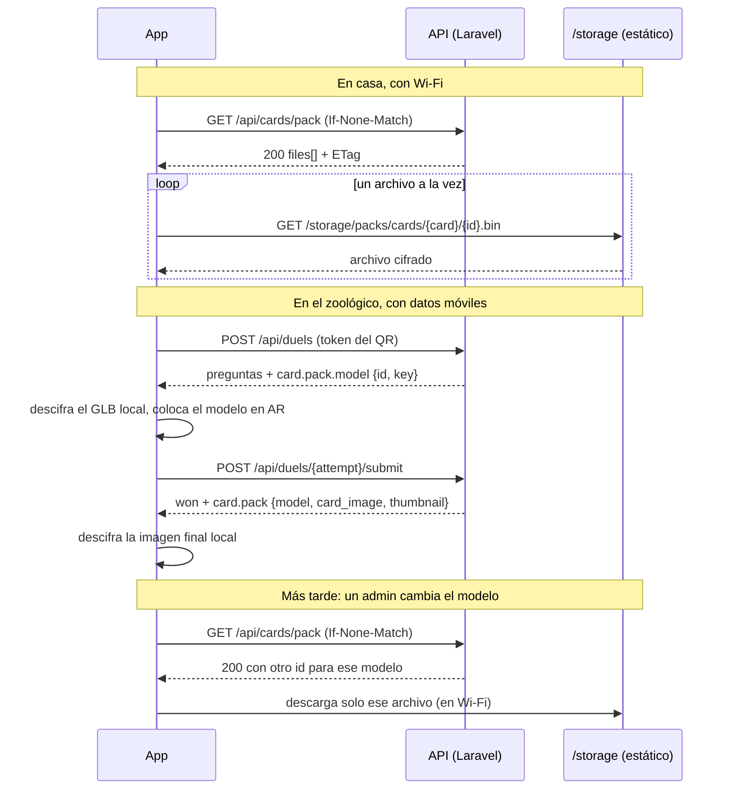

# Paquetes sin conexión de ZooDeck: servidor y contrato de la API

> **Estado:** servidor implementado (2026-11-12); la app móvil todavía no.
> Este documento es la **fuente de verdad del contrato**. La parte de la app móvil
> está en [offline-packs-app.md](offline-packs-app.md).

ZooDeck se juega **dentro del zoológico**, donde la mayoría de los visitantes usa
**datos móviles con planes limitados**. Hoy la app descarga por URL cada modelo 3D,
imagen de tarjeta y miniatura cada vez que los necesita, y al escanear un QR baja el
GLB del animal en ese momento, con datos móviles.

Los **paquetes sin conexión** permiten que la app descargue **en casa, con Wi-Fi**,
los archivos de **todas** las tarjetas activas, **cifrados**. Ya en el zoológico,
escanear o capturar una tarjeta solo descarga una **llave** de unos pocos bytes, con
la que la app abre un archivo que ya tiene. Las tarjetas sin capturar siguen ocultas:
sin su llave, sus archivos no se pueden leer.

## En resumen

| | |
| --- | --- |
| Qué cubre | Solo tarjetas: modelo 3D (`model_file`), imagen final (`generated_image`) y miniatura (`thumbnail_image`). |
| Unidad de descarga | **Cada archivo por separado.** No hay zip ni bundle (ver [abajo](#cada-archivo-se-descarga-y-se-gestiona-por-separado)). |
| Catálogo | `GET /api/cards/pack`: lista de archivos cifrados de todas las tarjetas activas, con `ETag` y `304`. |
| Llaves | Campo nuevo `pack` en `/api/cards` (tarjetas obtenidas) y en el inicio del duelo. |
| Cifrado | AES-256-GCM, una llave por archivo, derivada en el servidor (sin migración). |
| ¿Obligatorio? | No. La app puede seguir usando las URL de siempre como respaldo. |
| ¿Rompe algo? | No. Solo **agrega** un endpoint y un campo; los campos actuales no cambian. |
| Almacenamiento | El disco `public` de siempre, en `storage/app/public/packs/`. Sin S3. |

### Presupuesto de datos

Medido con las tarjetas actuales: **unos 1.5 MB por tarjeta** (GLB de unos 820 KB,
imagen final de hasta unos 650 KB y miniatura de unos 50 KB).

| Momento | Red | Datos |
| --- | --- | --- |
| Descarga completa, en casa | Wi-Fi | unos 1.5 MB × número de tarjetas activas |
| Revisar si hay cambios | cualquiera | unos 200 B (respuesta `304`) |
| Escanear un QR (inicio del duelo) | datos móviles | unos 1 KB de JSON; el GLB ya está en el teléfono |
| Ganar un duelo | datos móviles | unos 1 KB de JSON con las llaves |
| Un archivo cambió en el panel | Wi-Fi (por defecto) | solo ese archivo |



## Decisiones y por qué

### Cada archivo se descarga y se gestiona por separado

Un "paquete" **no es un zip ni un bundle**: es el conjunto de archivos `.bin`
individuales que lista el catálogo. Cada tarjeta tiene hasta **3 entradas**
(`model`, `card_image`, `thumbnail`), y cada entrada tiene su propio `id` (que es su
versión), su `url`, `bytes`, `sha256` y su llave. Cada una se descarga, se verifica,
se descifra, se actualiza y se borra **por su cuenta**:

- Si se cambia la escala de un modelo, solo cambia la entrada `model` de esa tarjeta.
  Las demás tarjetas y las imágenes de esa misma tarjeta no se tocan.
- Si una descarga se corta, solo se reintenta o se reanuda ese archivo.
- "Descargar todo" en la app solo pone en cola las entradas que faltan; el total que
  se muestra es la suma de sus `bytes`.

Un zip obligaría a volver a bajar **todo** cuando cambie un solo archivo, no se podría
reanudar a medias y el servidor tendría que armarlo.

### Opcional con respaldo por URL, no obligatorio

Obligar a descargar todo antes de jugar bloquearía la primera visita justo en la
entrada del zoológico, con datos móviles. La app ofrece el paquete, pero si un archivo
no está en el teléfono usa la URL de siempre (`model_url`, `card_image_url`,
`thumbnail_image`). El respaldo también cubre archivos borrados por el sistema,
corruptos o que todavía no terminan de bajar.

### Miniaturas e imágenes finales incluidas

Son WebP y pesan poco al lado del GLB, pero la cuadrícula de la colección las pide en
cada visita. Incluirlas ahorra más peticiones que los modelos.

### Cifrado en lugar de "solo las tarjetas obtenidas"

| Opción | Datos en el zoológico | Tarjetas sin capturar |
| --- | --- | --- |
| Solo tarjetas obtenidas | unos 1.5 MB por captura, más el GLB al escanear | ocultas |
| Todas, sin cifrar | casi nada | **visibles** en el almacenamiento del teléfono |
| **Todas, cifradas (elegida)** | casi nada | ocultas: sin llave no se pueden leer |

### Sin migración

Cada archivo subido recibe un **nombre único** (`uniqid`, ver
`Admin/CardController.php` y `CardImageOptimizer`) y el anterior se borra. Una ruta
nunca cambia de contenido, así que **una ruta nueva es una versión nueva**. La llave
se deriva de la ruta y no hace falta guardarla.

### No rompe la app actual

Todo es aditivo: un endpoint nuevo y un campo `pack` nuevo. `model_url`,
`card_image_url` y `thumbnail_image` siguen iguales, así que las versiones anteriores
de la app siguen funcionando.

### Listo para S3 o CDN

La app trata las `url` como opacas. Si después los archivos se mueven a S3 o a un CDN,
solo cambian `CardResource::publicUrl()` y el disco; el contrato no.

## Cifrado

- **Algoritmo:** AES-256-GCM con `openssl_encrypt` (sin dependencias nuevas). IV
  aleatorio de 12 bytes y etiqueta de 16 bytes.
- **Formato del `.bin`:** `iv (12 bytes) | texto cifrado | etiqueta (16 bytes)`. Es el
  formato "combined" de `AESSealedData.fromCombined` en `expo-crypto`.
- **Ubicación:** `storage/app/public/packs/cards/{card_id}/{file_id}.bin`, servido en
  `/storage/packs/cards/{card_id}/{file_id}.bin`.
- **`file_id`:** el nombre del archivo original sin extensión, por ejemplo
  `6af52aabeff651.50278773`. Es opaco para la app y cambia cada vez que cambia el
  archivo.
- **Llave por archivo:** `HMAC-SHA256(secreto, "card-pack:v1:" . $path)`, es decir
  32 bytes, enviados en base64. `$path` es la ruta relativa guardada en la tarjeta.
- **Secreto:** `config('cards.packs.secret')` (`CARD_PACK_SECRET`), que por defecto se deriva de `APP_KEY`
  (`hash_hmac('sha256', 'card-pack', APP_KEY)`). Si cambia el secreto, cambian todas
  las llaves y hay que reconstruir los paquetes (ver [Cambios](#cambios-en-los-archivos-de-una-tarjeta)).
- **Regla de las llaves:** **la API envía la llave de un archivo exactamente donde ya
  envía su URL en claro.** Nunca antes.

  | Respuesta | Llaves |
  | --- | --- |
  | `GET /api/cards`, tarjeta obtenida | `model`, `card_image`, `thumbnail` |
  | `GET /api/cards`, tarjeta sin obtener | ninguna |
  | `POST /api/duels` (inicio, tras escanear el QR) | `model`, `thumbnail` |
  | `POST /api/duels/{attempt}/submit` al ganar | `model`, `card_image`, `thumbnail` |
  | `GET /api/cards/pack` | **ninguna**, nunca |

## Contrato de la API

### `GET /api/cards/pack`

Catálogo de los archivos cifrados de **todas** las tarjetas activas. Es igual para
todos los usuarios y **nunca incluye llaves**.

| | |
| --- | --- |
| Ruta y nombre | `GET /api/cards/pack`, `api.cards.pack` |
| Autenticación | `auth:sanctum` |
| Límite | `throttle:60,1` |
| Caché | `ETag` y `Last-Modified`; con `If-None-Match` responde `304` sin cuerpo. `Cache-Control: private`. |

```json
{
  "success": true,
  "data": {
    "generated_at": "2026-11-11T18:20:00-06:00",
    "total_bytes": 6281344,
    "files": [
      {
        "id": "6af52aabeff651.50278773",
        "card_id": 114,
        "kind": "model",
        "url": "https://zoo.example.com/storage/packs/cards/114/6af52aabeff651.50278773.bin",
        "bytes": 793812,
        "sha256": "9f2c…e1"
      },
      {
        "id": "6af49005bff775.71148544",
        "card_id": 114,
        "kind": "card_image",
        "url": "https://zoo.example.com/storage/packs/cards/114/6af49005bff775.71148544.bin",
        "bytes": 672962,
        "sha256": "41ab…07"
      },
      {
        "id": "6af4900263ffb6.46503822",
        "card_id": 114,
        "kind": "thumbnail",
        "url": "https://zoo.example.com/storage/packs/cards/114/6af4900263ffb6.46503822.bin",
        "bytes": 48211,
        "sha256": "c03d…9a"
      }
    ]
  }
}
```

| Campo | Tipo | Descripción |
| --- | --- | --- |
| `generated_at` | string ISO 8601 | Cuándo se armó el catálogo. También va en `Last-Modified`. |
| `total_bytes` | int | Suma de `bytes` de todas las entradas. |
| `files[].id` | string | Versión del archivo. Si cambia, el archivo cambió. |
| `files[].card_id` | int | Tarjeta a la que pertenece. |
| `files[].kind` | `model` \| `card_image` \| `thumbnail` | Qué archivo es. Hay como máximo uno de cada tipo por tarjeta. |
| `files[].url` | string | URL absoluta del `.bin`, armada con `CardResource::publicUrl()`. |
| `files[].bytes` | int | Tamaño del `.bin`. |
| `files[].sha256` | string hex | Hash del `.bin`, para verificar la descarga. |

Solo aparecen las entradas cuyo `.bin` ya existe (ver [Cambios en los archivos de una
tarjeta](#cambios-en-los-archivos-de-una-tarjeta)). Las tarjetas inactivas no
aparecen. El catálogo no dice nada que `/api/cards` no diga ya: solo que la tarjeta
con ese `id` existe.

### Campo nuevo `pack` en las tarjetas

En `GET /api/cards`, **solo en tarjetas obtenidas**, y en `card` de la respuesta al
ganar un duelo (que usa el mismo `CardResource`):

```json
{
  "id": 114,
  "encountered": true,
  "name": "Gato montés",
  "model_url": "https://zoo.example.com/storage/cards/114/models/6af52aabeff651.50278773.glb",
  "card_image_url": "https://zoo.example.com/storage/cards/114/6af49005bff775.71148544.webp",
  "thumbnail_image": "https://zoo.example.com/storage/cards/114/6af4900263ffb6.46503822.webp",
  "pack": {
    "model": { "id": "6af52aabeff651.50278773", "key": "q3Jw…=" },
    "card_image": { "id": "6af49005bff775.71148544", "key": "Zt0e…=" },
    "thumbnail": { "id": "6af4900263ffb6.46503822", "key": "mP1x…=" }
  }
}
```

En `POST /api/duels`, dentro de `card` (que no tiene imagen final ni `id`):

```json
"pack": {
  "model": { "id": "6af52aabeff651.50278773", "key": "q3Jw…=" },
  "thumbnail": { "id": "6af4900263ffb6.46503822", "key": "mP1x…=" }
}
```

| Campo | Tipo | Descripción |
| --- | --- | --- |
| `pack.<kind>` | objeto \| `null` | `null` si la tarjeta no tiene ese archivo. |
| `pack.<kind>.id` | string | El mismo `id` que en el catálogo. |
| `pack.<kind>.key` | string base64 | Llave AES de 32 bytes de **ese** archivo. |

El `id` de `pack` siempre es el **actual**, aunque su `.bin` todavía se esté
reconstruyendo.

### Errores

| Caso | Respuesta |
| --- | --- |
| Sin token | `401`, como todo `auth:sanctum` |
| Demasiadas peticiones | `429` |
| `.bin` que ya no existe (se reemplazó a mitad de la descarga) | `404` del servidor web; la app vuelve a pedir el catálogo |

## Cambios en los archivos de una tarjeta

Una ruta nueva es una versión nueva, así que **el servidor no tiene que "avisar" de
cada cambio: basta con que el catálogo y `pack` muestren el `id` nuevo.**

| Qué cambió en el panel | Qué hace el servidor | Qué ve la app |
| --- | --- | --- |
| Escala del modelo o GLB nuevo | `model_file` cambia de ruta. Después del commit, `CardPackObserver` escribe el `.bin` nuevo, borra el anterior y limpia la caché del catálogo. | `ETag` nuevo en `/cards/pack`, con otro `id` en la entrada `model`. |
| Diseño nuevo de la tarjeta: fuente, colores, ilustración o cualquier otro ajuste del editor | Al guardar, el editor vuelve a generar la imagen completa y `generated_image` cambia de ruta. Mismo flujo. | Otro `id` en `card_image`. |
| Miniatura nueva | `thumbnail_image` cambia de ruta. Mismo flujo. | Otro `id` en `thumbnail`. |
| Imagen convertida con `cards:images:optimize` | Ruta nueva. Mismo flujo. | Otro `id`. |
| Miniatura o imagen final eliminada (botón de quitar imagen) o modelo eliminado | La columna queda en `null`. El observer borra ese `.bin`. | La entrada desaparece del catálogo y `pack.<kind>` llega como `null`. |
| Nombre, estadísticas o rareza | Cambia el JSON y, como se guarda desde el editor, también la imagen final (van dibujados en ella). | El JSON llega con `/api/cards` y su `ETag`; la imagen, como cualquier diseño nuevo. |
| Tarjeta desactivada | Sale del catálogo; su `.bin` se queda hasta borrarla. | Sus entradas desaparecen del catálogo y la app borra su copia. |
| Tarjeta eliminada | Se borra `packs/cards/{card_id}/`. | Igual que desactivada. |
| Rotación del secreto | `php artisan cards:packs:build --force` cifra todo de nuevo. | Mismos `id`, todos los `sha256` cambian; la app vuelve a bajar todo en Wi-Fi. |

**Las tres rutas que cambian un archivo pasan por Eloquent**, así que el observer
siempre se entera:
- Al subir desde el editor (modelo, miniatura o diseño nuevo de la tarjeta),
  `Admin/CardController::storeCardFiles()` y `storeModelFiles()` guardan con
  `uniqid` y llaman a `$card->update()`.
- Al convertir una imagen, `CardImageOptimizer::replace()` guarda con `uniqid` y
  llama a `$locked->update()`.
- Al eliminar una imagen, `Admin/CardController::destroyImage()` llama a
  `$card->update([... => null])`.

Las tres corren dentro de `DB::transaction`, por eso el observer **tiene** que correr
después del commit (`ShouldHandleEventsAfterCommit`). Si en el futuro se cambia una ruta
con `Card::query()->update()` o con `saveQuietly()`, el observer no se entera y hay que
llamar a `CardPackBuilder::sync()` y `CardPackCatalog::forget()` a mano.

**El diseño completo de la tarjeta vive en `generated_image`.** La fuente, los colores,
el título y las estadísticas van dibujados dentro de esa imagen. La app no recibe
`fade_color` ni los ajustes de fuente y no dibuja la tarjeta: solo muestra
`card_image_url`. Cada vez que se guarda en el editor, `pages/admin/cards/Edit.vue`
vuelve a generar la imagen desde la vista previa (`generateCardFile()`) y la sube.
Por eso **cualquier cambio de diseño** (fuente, color, nombre o estadísticas) produce
un `generated_image` nuevo, con otro `id`, y la app baja solo esa imagen. El reverso
de la tarjeta es un GLB incluido en la app (`assets/models/card/Back.glb`), así que
cambiarlo requiere una actualización de la app.

Si el navegador no logra generar la imagen al guardar, se guardan los datos pero la
imagen sigue siendo la anterior, y la app tampoco ve el cambio. Es un problema del
editor, no del paquete: hay que avisar al admin en ese caso.

**Archivos sin copia cifrada.** El `.bin` se escribe en la misma petición que guarda la
tarjeta, así que normalmente no hay espera. Solo falta si el cifrado falló o si el
archivo es anterior y todavía no se corrió `cards:packs:build`. En ese caso `/api/cards`
y el inicio del duelo devuelven el `id`, pero el catálogo no lo lista, y la app usa la
URL en claro o su copia anterior (ver la guía de la app).

### Cómo se entera la app (sin notificaciones push)

1. **Al abrir, al volver al primer plano y al recuperar la conexión** pide
   `/api/cards/pack` con `If-None-Match`. Si nada cambió, recibe un `304` de unos
   200 bytes.
2. **`/api/cards`**, que la app ya pide con `ETag`, trae los `pack.*.id` actuales de
   sus tarjetas.
3. **El inicio del duelo** trae los `id` actuales de la tarjeta escaneada.

Si un `id` local no coincide con el del servidor, **ese archivo** está desactualizado.

## Recomendaciones para el servidor

- **Bajar `GLB_MAX_FILE_SIZE`** (hoy 50 MB en `config/glb.php`) a unos 10 MB y avisar
  en el editor de tarjetas arriba de unos 3 MB. En datos móviles, cada MB cuenta, y
  descifrar un archivo enorme en el teléfono es lento.
- **Caché del servidor web:** servir `/storage/packs/` y `/storage/cards/` con
  `Cache-Control: public, max-age=31536000, immutable`. Es seguro porque los nombres
  nunca se reutilizan.
- **Reanudar descargas:** nginx y Apache aceptan `Range` en archivos estáticos, así que
  la app puede reanudar una descarga cortada. **`php artisan serve` no:** el servidor
  integrado de PHP responde `200` con el archivo completo (comprobado el 2026-11-12), y
  la app debe empezar ese archivo de cero cuando eso pase.

## Implementación

Implementado en la rama `feat/paquetes-sin-conexion` (2026-11-12).

| Pieza | Archivo |
| --- | --- |
| Configuración | `config/cards.php` → `packs.enabled` (`CARD_PACKS_ENABLED`), `packs.secret` (`CARD_PACK_SECRET`), `packs.disk`, `packs.directory` |
| Tipos de archivo | `app/Enums/CardPackKind.php` (`model`, `card_image`, `thumbnail`, con su columna y su disco) |
| Cifrado y llaves | `app/Services/CardPack/CardPackBuilder.php`: `key()`, `fileId()`, `refs()`, `sync()`, `remove()`, `encrypt()`, `decrypt()` |
| Catálogo | `app/Services/CardPack/CardPackCatalog.php`, copiado de `Licensing/CreditsCatalog` |
| Sincronización | `app/Observers/CardPackObserver.php`, registrado en `Card` junto a `CreditsCacheObserver` |
| Endpoint | `Api\CardController@pack`, ruta `api.cards.pack` |
| Llaves en respuestas | `CardResource` (tarjetas obtenidas) y `Duel\DuelStartResource` (modelo y miniatura) |
| Comando | `php artisan cards:packs:build {--card=*} {--force}` |
| Pruebas | `tests/Feature/Api/CardPackTest.php` |

Decisiones tomadas al implementar:

- **Sin cola.** El proyecto no usa colas en ningún otro lado, y depender de un worker
  en producción solo para esto era un riesgo. El observer implementa
  `ShouldHandleEventsAfterCommit` y cifra **en la misma petición, después del commit**:
  unos MB tardan milisegundos. Así no hay ventana en la que la tarjeta ya cambió y su
  copia todavía no existe.
- **El observer no mira `wasChanged()`.** El editor guarda la tarjeta varias veces en
  una misma transacción, y después del commit todos los eventos llegan con los cambios
  del último guardado. `sync()` es idempotente y casi gratis cuando no hay nada nuevo,
  así que corre en cada `saved`.
- **Si falla el cifrado, la tarjeta igual se guarda.** El error se reporta con
  `report()` y `cards:packs:build` lo repara después.
- **El catálogo guarda rutas relativas en caché** y arma las URL en cada petición,
  porque `CardResource::publicUrl()` usa el host de la petición (la IP de la red local en
  desarrollo).
- **El hash de cada `.bin` se guarda en caché** con su IV (aleatorio en cada cifrado)
  como parte de la llave de caché, para no volver a leer todos los archivos cada vez
  que se invalida el catálogo.
- **Escritura atómica:** cada `.bin` se escribe como `.tmp` y luego se mueve.
- **Interruptor:** con `CARD_PACKS_ENABLED=false` no se escribe ni se borra nada. Las
  pruebas lo apagan en `phpunit.xml`, para que las pruebas que crean tarjetas nunca
  toquen `storage/` real. `CardPackTest` lo enciende sobre `Storage::fake('public')`.
- **Límite de memoria:** `openssl_encrypt` cifra el archivo completo en memoria. Con
  el límite actual de 50 MB por GLB, un modelo enorme puede acercarse a
  `memory_limit`; otra razón para bajar `GLB_MAX_FILE_SIZE`.

### Puesta en marcha

1. Desplegar y correr `php artisan cards:packs:build` una vez, para crear las copias
   de las tarjetas que ya existen. Después el observer las mantiene solo.
2. Opcional: definir `CARD_PACK_SECRET`. Si cambia (o cambia `APP_KEY` sin él),
   correr `php artisan cards:packs:build --force`.
3. Opcional: configurar el servidor web con `Cache-Control: immutable` (ver arriba).

## Fuera de alcance

- **Duelos sin conexión** (calificación diferida): tendrán su propio documento. Hoy
  el duelo sigue necesitando conexión, aunque ya no descarga el modelo.
- Paquetes de especies, eventos y mapa.
- S3 o CDN, y URL firmadas. Hoy `/storage` es público y los nombres `uniqid` se basan
  en la hora, así que no son secretos. Los `.bin` no necesitan serlo, porque están
  cifrados.
- Una imagen final de menor resolución (1×) para ahorrar más datos.
